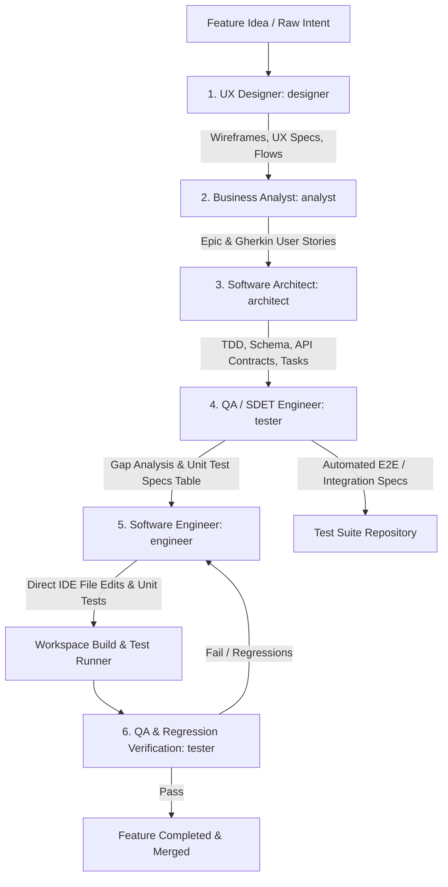

# Feature Lifecycle Workflow: End-to-End Agentic SDLC

This workflow defines the chained execution lifecycle for developing features in **Google Antigravity IDE** using specialized subagents: **UX Designer**, **Business Analyst**, **Software Architect**, **QA/Test Engineer**, and **Software Engineer**.

---

## Workflow Overview

---

## Step-by-Step Chained Protocol

### Stage 1: UX/UI Discovery & Information Architecture
* **Agent:** `designer` (`.agents/agents/designer.md`)
* **Input:** High-level feature concept or raw user requirement.
* **Process:** 
  * Inquires regarding user personas and primary problem statements.
  * Formulates Information Architecture, user flows (Mermaid), and UI layout wireframes.
  * Adds WCAG 2.2 accessibility checks and UX interaction constraints.
* **Output Artifacts:** 
  * Low-fidelity text wireframe specification.
  * UI state and interaction logic.

---

### Stage 2: Formal Requirements & Business Analysis
* **Agent:** `analyst` (`.agents/agents/analyst.md`)
* **Input:** Designer's wireframes + User's business objectives.
* **Process:**
  * Validates scope boundaries (In-Scope vs. Out-of-Scope).
  * Defines Non-Functional Requirements (NFRs: scale, latency, security, compatibility).
  * Formulates Epic and granular User Stories with Gherkin syntax (`Given/When/Then`).
* **Output Artifacts:**
  * Formatted Epic document with KPIs.
  * Granular User Stories (`US-xxx`) with acceptance criteria and dev notes.

---

### Stage 3: Technical Blueprint & System Architecture
* **Agent:** `architect` (`.agents/agents/architect.md`)
* **Input:** Epic and User Stories from the Business Analyst.
* **Process:**
  * Evaluates architectural feasibility, security trade-offs (OWASP), and data consistency.
  * Produces Mermaid.js sequence and component diagrams.
  * Defines data persistence schema changes (SQL/NoSQL/Migrations) and caching strategies.
  * Specifies API contracts (Endpoints, request/response JSON schemas, auth scopes).
  * Deconstructs the architecture into developer-assignable task tickets.
* **Output Artifacts:**
  * Technical Design Document (`TDD`).
  * Initialized / updated `IMPLEMENTATION_PLAN.md`.
  * Architectural Decision Records (`docs/adr/`).

---

### Stage 4: "Shift-Left" QA & Test Specification
* **Agent:** `tester` (`.agents/agents/tester.md`)
* **Input:** Architecture Blueprint, `IMPLEMENTATION_PLAN.md`, and User Stories.
* **Process:**
  * **Destructive Gap Analysis:** Identifies logic flaws, missing error handlers, edge cases, and security vulnerabilities.
  * **Unit Test Specifications:** Produces a strict input/output mapping table for dev implementation.
  * **E2E & Integration Tests:** Authors runnable test suites (e.g., Jest, Supertest, Cypress, Playwright).
* **Output Artifacts:**
  * Unit Test Specifications table (handed off to Engineer).
  * Test files in `tests/integration/` or `tests/e2e/`.

---

### Stage 5: TDD Implementation (Antigravity IDE vs. Web Chatbot)

#### A. Default: Native Execution in Antigravity IDE
* **Agent:** `engineer` (`.agents/agents/engineer.md`)
* **Input:** Architect's Task Breakdown + QA's Unit Test Specifications table.
* **Process:**
  * **System 2 Mental Sandbox:** Analyzes blast radius, edge cases, and regression risks.
  * **Red-Green-Refactor Cycle:**
    1. **Red:** Writes/updates unit tests directly in the workspace test files matching QA specifications.
    2. **Green:** Implements minimal, clean, self-descriptive business logic to pass all tests.
    3. **Refactor:** Optimizes and cleans code, enforcing `.agents/skills/vercel-react-best-practices/SKILL.md`.
  * Executes direct surgical file edits inside Antigravity (no PatchPilot formatting overhead).
* **Output Artifacts:**
  * Implemented source and unit test files directly in workspace.
  * Incremental updates to `IMPLEMENTATION_PLAN.md` checklist.

#### B. Alternative: Hybrid Web Chatbot Workflow
* **Agent:** `engineer-webchatbot` (`.agents/agents/engineer-webchatbot.md`)
* **Usage:** Used *only* when running sessions via external web chatbots (Gemini / Claude Web) where the user manually executes patches.
* **Format:** Outputs single atomic Git Unified Diffs (`PatchPilot` protocol).

---

### Stage 6: Automated Verification & Regression Review
* **Agent:** `tester` + Antigravity Test Runner
* **Process:**
  * Runs the full test suite (unit, integration, regression) within the IDE.
  * Validates that all blast-radius components and edge cases remain fully functional.
  * If tests fail or regressions occur, returns to Stage 5 with specific failure logs for remediation.
  * Once all checks pass, marks feature implementation complete in `IMPLEMENTATION_PLAN.md`.
