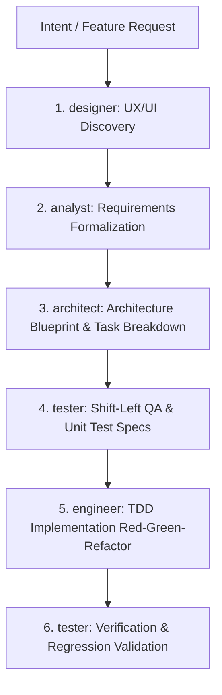

# Antigravity Agents, Workflows & Skills (Qozara)

This repository contains modular subagent personas, engineering skills, and deterministic SDLC workflows for **Google Antigravity IDE**. It pairs high-level cognitive orchestration personas with granular execution skills from the curated [rmyndharis/antigravity-skills](https://github.com/rmyndharis/antigravity-skills) catalog.

---

## 📂 Repository Structure

```
antigravity-agents/
├── .agents/
│   ├── subagents/
│   │   ├── designer.md                  # Product UX/UI Designer (Aura)
│   │   ├── analyst.md                   # Software Business Analyst (Epics & Gherkin User Stories)
│   │   ├── architect.md                 # Software Architect Agent (TDD, Diagrams, API & Task Breakdown)
│   │   ├── engineer.md                  # Software Engineer Agent (TDD & PatchPilot Unified Diff)
│   │   └── tester.md                    # Software QA/Test Engineer (Gap Analysis, Unit Specs, Breaker Tests)
│   ├── skills/
│   │   └── vercel-react-best-practices.md # Core React, React Native, & Component Architecture
│   └── workflows/
│       └── feature-lifecycle.md         # End-to-End Chained Feature Development Lifecycle
├── setup-symlinks.sh                    # Symlink orchestrator targeting ~/.antigravity/agents
└── README.md
```

---

## 🏗️ Architecture & Division of Responsibilities

The system operates across two complementary layers:

1. **Cognitive & SDLC Personas (`.agents/subagents/` & `.agents/workflows/`):**  
   Defined in this repository. These handle meta-reasoning, state tracking (`IMPLEMENTATION_PLAN.md`, `docs/adr/`), TDD enforcement, and role handoffs across the lifecycle.
2. **Domain-Specific Execution Skills (`~/.gemini/antigravity/skills/`):**  
   Sourced from `@rmyndharis/antigravity-skills`. These provide low-level idioms, framework conventions, security audit checklists, and testing patterns invoked on demand by Antigravity during execution.

---

## 🤖 Subagent Overview

| Subagent | Role & Objective | Primary Artifacts | Key Skills Consumed |
| :--- | :--- | :--- | :--- |
| **`designer`** | User-Centric Design Strategist & UI Architect | Wireframes, User Flows (Mermaid), WCAG 2.2 Checks | `react-modernization`, `frontend-mobile-development-component-scaffold` |
| **`analyst`** | Senior Technical Business Analyst | Epics, KPIs, Gherkin User Stories (`US-xxx`) | `c4-architecture-c4-architecture`, `api-design-principles` |
| **`architect`** | Principal Software Architect & Tech Lead | TDD, Sequence Diagrams, API Contracts, Task Decomposition | `c4-architecture-c4-architecture`, `core-dev` bundle |
| **`tester`** | Hostile Senior QA / SDET Engineer | Gap Analysis, Unit Test Specs, Breaker Tests | `e2e-testing-patterns`, `security-auditor`, `security-scanning-security-hardening` |
| **`engineer`** | Autonomous Software Engineer | Atomic Unified Diffs (`PatchPilot`), Unit Test Implementations | `tdd-workflows-tdd-cycle`, `typescript-pro`, `codebase-cleanup-tech-debt` |

---

## 🔄 Chained Workflow: Feature Lifecycle

The workflow defined in `.agents/workflows/feature-lifecycle.md` enforces a deterministic progression:



1. **UX/UI Discovery** (`designer`): Interaction logic and WCAG compliance.
2. **Requirements Definition** (`analyst`): Formal Epics and Gherkin User Stories.
3. **Architecture Blueprint** (`architect`): System design, API contracts, schema migrations, and `IMPLEMENTATION_PLAN.md`.
4. **Shift-Left QA** (`tester`): Security audit, gap analysis, and Unit Test specification tables.
5. **TDD Implementation** (`engineer`): Red-Green-Refactor using atomic unified diffs (`PatchPilot`).
6. **Verification** (`tester`): Automated test execution and regression sign-off.

---

## 🚀 Machine Setup & Installation

To configure an environment on a new workstation, clone this repository and run the setup sequence below:

```bash
# 1. Clone this repository
git clone <YOUR-REPO-URL> ~/VSCodeProjects/qozara/antigravity-agents
cd ~/VSCodeProjects/qozara/antigravity-agents

# 2. Expose custom personas and workflows globally
chmod +x setup-symlinks.sh
./setup-symlinks.sh

# 3. Install core execution skills from rmyndharis catalog
npx @rmyndharis/antigravity-skills install --bundle core-dev --global && \
npx @rmyndharis/antigravity-skills install \
  react-modernization \
  frontend-mobile-development-component-scaffold \
  c4-architecture-c4-architecture \
  e2e-testing-patterns \
  security-auditor \
  security-scanning-security-hardening \
  tdd-workflows-tdd-cycle \
  typescript-pro \
  codebase-cleanup-tech-debt \
  --global
```

---

## 🛠️ Usage in Antigravity IDE

### 1. Invoking Subagents via `@` Mentions or Keywords

Antigravity parses markdown agent profiles in `.agents/subagents/`. In the chat panel or Mission Control, you can explicitly summon personas using `@` mentions or natural language prompts:

* **`@designer`** (`.agents/subagents/designer.md`): Information architecture, wireframe specs, and WCAG accessibility notes.
  ```text
  @designer Create wireframe specs and user flow for the multi-currency transaction modal.
  ```
* **`@analyst`** (`.agents/subagents/analyst.md`): Discovery interview, formal Epics, acceptance criteria, and Gherkin User Stories (`US-xxx`).
  ```text
  @analyst We need to support offline transaction sync for mobile users. Start discovery.
  ```
* **`@architect`** (`.agents/subagents/architect.md`): Technical Design Documents (TDD), Mermaid sequence diagrams, API contracts, and task breakdown.
  ```text
  @architect Here are the user stories from the analyst. Generate the TDD, schema migrations, and tasks.
  ```
* **`@tester`** (`.agents/subagents/tester.md`): Hostile QA audit, security gap analysis, and the **Unit Test Specifications Table** for TDD handoff.
  ```text
  @tester Audit this architecture spec for vulnerabilities and output the Unit Test Specs table.
  ```
* **`@engineer`** (`.agents/subagents/engineer.md`): TDD cycle (Red-Green-Refactor) delivering atomic changes via **PatchPilot Unified Diffs**.
  ```text
  @engineer Implement Task 1 following the Unit Test Specs provided by QA.
  ```

---

### 2. Executing the Chained Workflow

To execute the end-to-end SDLC pipeline:

1. **Trigger via Chat:** Reference `@feature-lifecycle` or trigger the workflow:
   ```text
   Run @feature-lifecycle for requirement: "Implement user email verification and token expiry"
   ```
2. **Sequential Agent Handoff:**
   * **Stage 1 (UX/UI & Requirements):** `@designer` creates the layout $\rightarrow$ `@analyst` converts it to Gherkin user stories.
   * **Stage 2 (Architecture):** `@architect` maps data flow and outputs assignable tasks (`T-01`, `T-02`, etc.) in `IMPLEMENTATION_PLAN.md`.
   * **Stage 3 (Shift-Left QA):** `@tester` inspects architecture for edge cases, missing error statuses, and produces the input/output test matrix.
   * **Stage 4 (Implementation):** `@engineer` implements failing unit tests first, codes the logic, and delivers the single atomic `diff --git` block.
   * **Stage 5 (Verification):** `@tester` writes and validates integration/E2E test suites (`*.spec.ts`).

---

### 3. Model Tiers & Slash Command Routing

Optimize token consumption and response quality by routing models to the task complexity:

| Agent / Phase | Recommended Antigravity Tier | Slash Command | Rationale |
| :--- | :--- | :--- | :--- |
| **`@designer`**, **`@analyst`**, **`@architect`** | **Planning Mode** (Gemini Pro / Claude Opus) | `/pro` or `/opus` | Deep reasoning, trade-off analysis, system design, and formal specification. |
| **`@tester`** (Gap Analysis & Security) | **Planning Mode** | `/pro` | Hostile inspection and threat modeling require high reasoning. |
| **`@engineer`** (Code & Patch Generation) | **Fast Mode** (Gemini Flash) | `/flash` | High-speed, low-cost code implementation following pre-defined test specifications. |

---

### 4. Global vs. Project Scope

* **Global Access (`~/.antigravity/agents`)**: The symlink created by `setup-symlinks.sh` makes all agents, skills, and workflows globally available in any workspace opened in Antigravity.
* **Workspace Overrides**: Adding a local `.agents/` folder at the root of a specific project (e.g., `quozen`) allows overriding or extending specific subagents or workflows for that repository.
* **Skill Auto-Discovery**: Skills installed globally in `~/.gemini/antigravity/skills/` (and local `.agents/skills/`) are automatically injected by Antigravity based on active file context and agent instructions.
